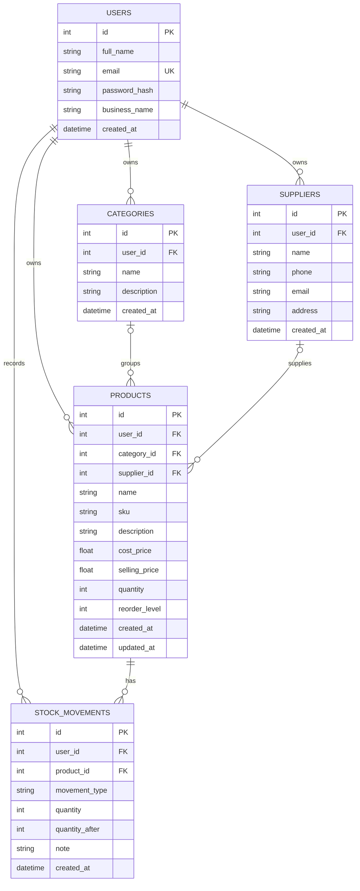

# ERD and Data Dictionary

The database tables in `backend/app/models.py` match this ERD exactly.
Render the diagram on GitHub, or paste the Mermaid block into https://mermaid.live
and export an image to `docs/erd.png` for the design document.

## Relationships (cardinality)

| Relationship | Type | Implemented by |
|--------------|------|----------------|
| One user has many categories | 1:N | `categories.user_id` → `users.id` |
| One user has many suppliers | 1:N | `suppliers.user_id` → `users.id` |
| One user has many products | 1:N | `products.user_id` → `users.id` |
| One category has many products (optional) | 1:N | `products.category_id` → `categories.id` |
| One supplier supplies many products (optional) | 1:N | `products.supplier_id` → `suppliers.id` |
| One product has many stock movements | 1:N | `stock_movements.product_id` → `products.id` |
| One user has many stock movements | 1:N | `stock_movements.user_id` → `users.id` |

No many-to-many relationships, so no junction table is needed. The tables are in 3NF:
every non-key column depends only on its table's primary key (category and supplier names
are stored once and looked up through foreign keys).

## Data dictionary

### users
| Field | Type | Size | Constraints | Meaning |
|-------|------|------|-------------|---------|
| id | INTEGER | – | PK, auto | User id |
| full_name | VARCHAR | 100 | NOT NULL | Owner's name |
| email | VARCHAR | 255 | NOT NULL, UNIQUE, indexed | Login name (stored lowercase) |
| password_hash | VARCHAR | 255 | NOT NULL | bcrypt hash, never the password |
| business_name | VARCHAR | 150 | NULL | Shop / company name |
| created_at | DATETIME | – | NOT NULL | Sign-up time (UTC) |

### categories
| Field | Type | Size | Constraints | Meaning |
|-------|------|------|-------------|---------|
| id | INTEGER | – | PK, auto | Category id |
| user_id | INTEGER | – | FK → users.id, NOT NULL | Owner |
| name | VARCHAR | 80 | NOT NULL, UNIQUE with user_id | e.g. "Drinks" |
| description | VARCHAR | 255 | NULL | Optional note |
| created_at | DATETIME | – | NOT NULL | Created time |

### suppliers
| Field | Type | Size | Constraints | Meaning |
|-------|------|------|-------------|---------|
| id | INTEGER | – | PK, auto | Supplier id |
| user_id | INTEGER | – | FK → users.id, NOT NULL | Owner |
| name | VARCHAR | 120 | NOT NULL | Supplier name |
| phone | VARCHAR | 30 | NULL | Contact phone |
| email | VARCHAR | 255 | NULL | Contact email |
| address | VARCHAR | 255 | NULL | Location |
| created_at | DATETIME | – | NOT NULL | Created time |

### products
| Field | Type | Size | Constraints | Meaning |
|-------|------|------|-------------|---------|
| id | INTEGER | – | PK, auto | Product id |
| user_id | INTEGER | – | FK → users.id, NOT NULL | Owner |
| category_id | INTEGER | – | FK → categories.id, NULL | Product group |
| supplier_id | INTEGER | – | FK → suppliers.id, NULL | Usual supplier |
| name | VARCHAR | 150 | NOT NULL, indexed | Product name |
| sku | VARCHAR | 50 | NOT NULL, UNIQUE with user_id | Stock-keeping code |
| description | VARCHAR | 500 | NULL | Optional details |
| cost_price | FLOAT | – | ≥ 0 | Buying price (UGX) |
| selling_price | FLOAT | – | ≥ 0 | Selling price (UGX) |
| quantity | INTEGER | – | ≥ 0 | Units in stock now |
| reorder_level | INTEGER | – | ≥ 0 | Low-stock warning threshold |
| created_at / updated_at | DATETIME | – | NOT NULL | Audit times (UTC) |

### stock_movements
| Field | Type | Size | Constraints | Meaning |
|-------|------|------|-------------|---------|
| id | INTEGER | – | PK, auto | Movement id |
| user_id | INTEGER | – | FK → users.id, NOT NULL | Owner |
| product_id | INTEGER | – | FK → products.id, NOT NULL | Product affected |
| movement_type | VARCHAR | 10 | `in`, `out` or `adjust` | Kind of change |
| quantity | INTEGER | – | NOT NULL | Units moved (or counted level for `adjust`) |
| quantity_after | INTEGER | – | NOT NULL | Stock level after this movement |
| note | VARCHAR | 255 | NULL | Reason, e.g. "Sale", "Damaged" |
| created_at | DATETIME | – | NOT NULL | When it happened (UTC) |
